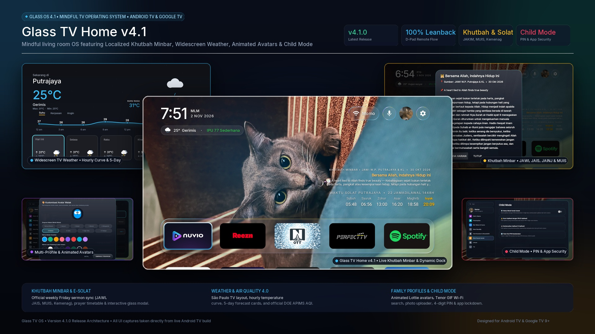
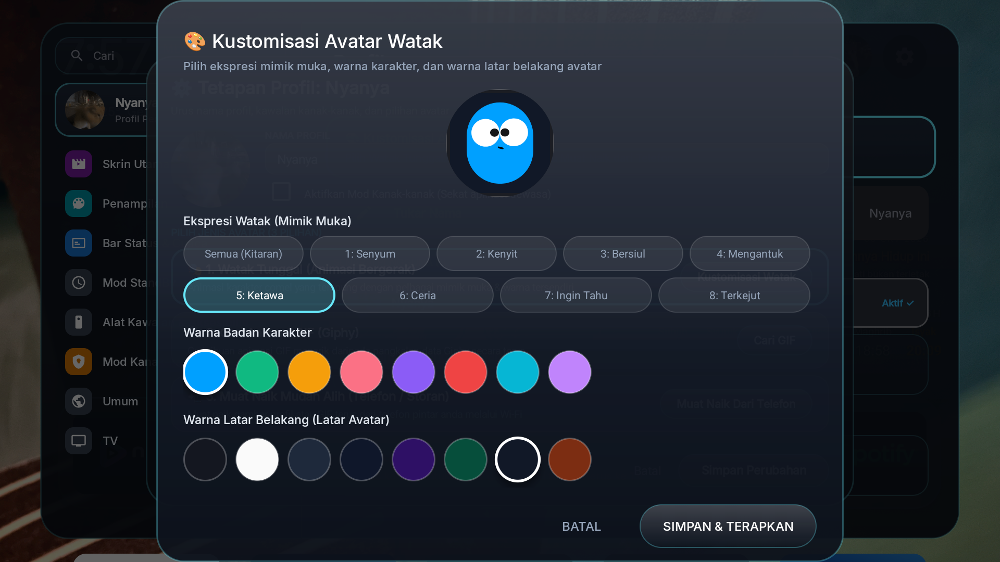
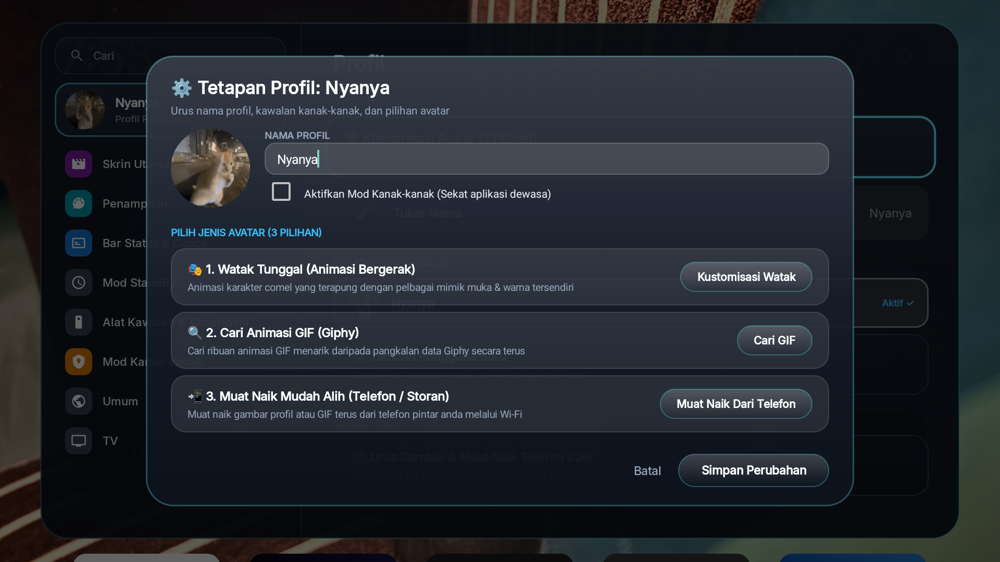
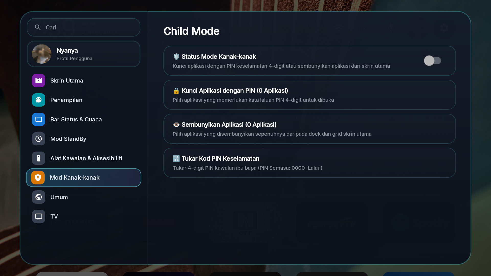
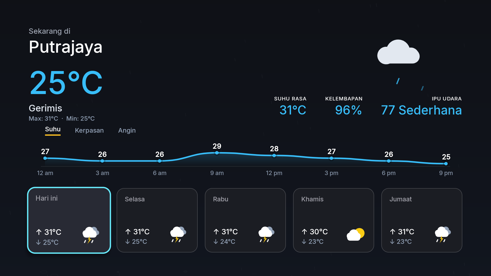
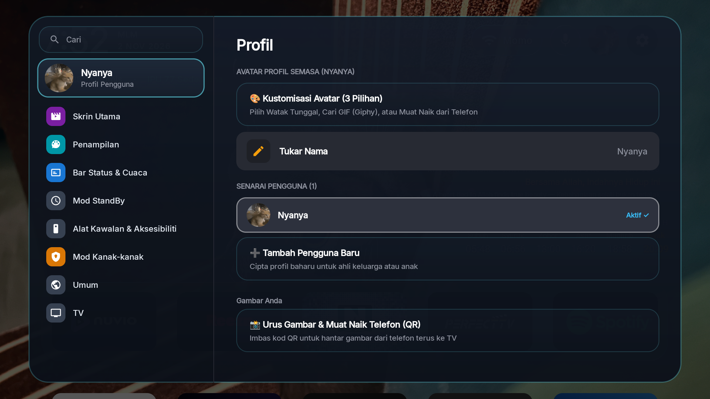

# Panduan Pengguna Glass TV Home (Untuk Beginner) 📺✨

Selamat datang ke **Glass TV Home**! Panduan ini khas untuk pengguna baru (*beginner-friendly*) supaya anda boleh memasang, mengoptimumkan TV agar laju tanpa iklan, menggunakan remote TV, dan menikmati semua ciri menarik dengan mudah tanpa pening kepala.

<p align="center">
  
</p>

---

## 🌟 1. Apa Itu Glass TV Home?

Glass TV Home ialah pengganti skrin utama (*launcher*) untuk Android TV dan Google TV (seperti Xiaomi Mi Box S, Mi TV Stick, Android TV Sharp, Sony, TCL, Philips, Mecool dsb):
* 🚀 **Tiada Iklan & Sangat Ringan**: Hanya bersaiz ~453 KB, lancar dan tidak membebankan TV (menjimatkan lebih 400 MB RAM berbanding skrin asal).
* 🪟 **Gaya Kaca Frosted (tvOS)**: Rekaan moden seperti Apple TV dengan bayang kaca terapung dan susunan aplikasi yang kemas.
* 🕌 **Waktu Solat & Ayat Harian**: Jadual 6 waktu solat Malaysia secara automatik dengan ayat al-Quran pilihan harian.
* ⛅ **Dashboard Cuaca & Jerebu (API)**: Semakan suhu semasa, ramalan 12 jam, 7 hari, serta indeks pencemaran udara rasmi (APIMS Jabatan Alam Sekitar).
* 🌙 **Screensaver Pintar & Jimat Elektrik**: Masuk screensaver selepas 10 minit rehat, dan TV padam automatik (*sleep standby*) selepas 2 jam.

---

## 📦 Muat Turun Fail APK Rasmi (Official Direct Downloads)

Sila muat turun fail pemasangan rasmi mengikut peranti anda:
* 📱 **Untuk Telefon / Tablet Android (Aplikasi Pembantu Pemasangan — Disyorkan)**:  
  [**`glass-tv-installer.apk`** (5.2 MB)](https://github.com/aqmangge/glass-tv-home/raw/main/release/glass-tv-installer.apk) — **Pilihan Utama!** Pasang terus ke TV dan kunci butang Home melalui Wi-Fi tanpa perlukan komputer (PC) atau kabel.
* 📺 **Untuk Android TV / Google TV (Launcher Utama v4.1)**:  
  [**`glass-tv-home.apk`** (2.0 MB)](https://github.com/aqmangge/glass-tv-home/raw/main/release/glass-tv-home.apk) — Versi terkini `v4.1.0` (Khutbah Minbar tempatan, pilihan paparan Doa/Minbar, dialog perincian kaca, navigasi alat kawalan jauh DPAD dua hala).

> [!CAUTION]
> ### ⚠️ JANGAN PASANG APK SECARA SIDELOAD BIASA TANPA INSTALLER / AI!
> Ramai pengguna baru memuat turun fail APK terus menggunakan pendrive atau *Downloader* di TV. Ini menyebabkan masalah:
> 1. **Butang Home Tidak Berfungsi**: Android TV / Google TV melayan Glass TV sebagai aplikasi sampingan biasa. Bila anda tekan butang **HOME** pada remote TV, skrin tetap akan kembali ke pelancar lama pengeluar.
> 2. **Menu Tetapan Disorok**: Google TV sengaja menyembunyikan pilihan untuk menukar default launcher daripada pengguna.
> 3. **Penyelesaian Paling Praktikal**: Gunakan **Aplikasi Telefon Pintar (`glass-tv-installer.apk`)** atau **Prompt AI 1-Baris** melalui komputer. Kedua-dua cara ini mengunci butang Home secara rasmi melalui arahan sistem (`cmd package set-home-activity`).

> [!NOTE]
> ### 🇲🇾 Pengguna Unifi TV Box (TM Unifi Plus Box): Adakah Boleh Guna & Adakah Batal Waranti?
> * **Boleh guna ke? YA, 100% BOLEH!** Unifi Plus Box (model Skyworth HP40A3, ZTE B866V2K, dan kotak Android TV baharu TM) menggunakan sistem operasi Android TV yang sah (*certified Android TV*). Aplikasi rasmi **unifi TV** (siaran langsung & saluran langganan anda) tetap ada dalam senarai aplikasi dan boleh ditonton seperti biasa.
> * **Adakah membatalkan waranti (void warranty)? TIDAK SAMA SEKALI!** Glass TV Home dipasang sebagai aplikasi biasa (*user-space APK*). Ia **TIDAK me-root (no root)** kotak TV anda, **TIDAK membuka bootloader**, dan **TIDAK mengubah sistem perisian dalaman TM (firmware)**. Anda boleh *uninstall* pada bila-bila masa melalui menu Tetapan TV untuk kembali kepada paparan asal TM tanpa sebarang kesan.

---

## 🚀 2. Panduan Pemasangan Mengikut Keutamaan Peranti Anda

Ikuti panduan mengikut peranti yang anda miliki dengan susunan keutamaan berikut:

### ⭐ Keutamaan 1: Pengguna Telefon Pintar Android (Fokus Utama — Paling Mudah & Disyorkan)

Jika anda mempunyai telefon pintar atau tablet Android, ini adalah kaedah **paling mudah, pantas, dan 100% automatik** tanpa memerlukan komputer atau sebarang kabel USB!

1. **Muat Turun & Pasang APK Pembantu di Telefon Android Anda**:
   - Muat turun [**`glass-tv-installer.apk`**](https://github.com/aqmangge/glass-tv-home/raw/main/release/glass-tv-installer.apk) (~5.2 MB) terus ke telefon pintar anda dan pasang (*install*).
2. **Persediaan Ringkas di TV (Sekali Sahaja)**:
   - Pada remote TV: Buka **Settings (Tetapan ⚙️)** $\rightarrow$ **System / Device Preferences** $\rightarrow$ **About (Mengenai)** $\rightarrow$ Skrol ke **Build (Android TV OS Build)**.
   - Tekan butang **OK remote sebanyak 7 kali berturut-turut** sehingga muncul *"You are now a developer!"*.
   - Tekan *Back*, masuk ke menu baharu **Developer options**, dan aktifkan:
     - ✅ **USB debugging** (Tukar kepada ON).
     - *(Jika ada Network/Wireless debugging, hidupkan juga)*.
   - Pastikan telefon Android dan TV anda bersambung pada **Wi-Fi yang sama**.
3. **1-Klik Pasang dari Telefon**:
   - Buka aplikasi **Glass TV Installer** di telefon anda.
   - Tekan butang **`🔍 Imbas Android TV di Rangkaian Wi-Fi`** — aplikasi akan mencari TV anda secara automatik!
   - Tekan butang biru **`🚀 Pasang Terus ke Android TV`**.
   - Pada skrin TV anda, tetingkap *"Allow USB debugging?"* akan muncul. Tandakan kotak ☑ **Always allow from this computer** dan tekan **OK / Allow** menggunakan remote TV.
   - Aplikasi di telefon akan menghantar dan memasang Glass TV Home terus ke TV dalam beberapa saat!
4. **Lancarkan Paparan Baharu**:
   - Tekan butang **`📺 Buka Glass TV Home di Skrin TV`** di telefon atau tekan butang Home pada remote TV.
   - Selesai! TV anda kini mempunyai paparan kaca moden yang sangat pantas.

> 💡 **Pilihan Pelayan Web Tempatan (Jika TV Tiada Debugging)**:  
> Jika TV anda sukar menghidupkan mod debugging, buka aplikasi di telefon dan tekan butang **`🌐 Pelayan Web TV`**. Kemudian buka aplikasi **Downloader** atau pelayar web di TV dan masukkan alamat IP tempatan yang tertera (cth: `http://192.168.x.x:8080`) untuk muat turun terus ke TV.

---

### 💻 Keutamaan 2: Jika Tiada Telefon Android — Guna Laptop atau PC (Windows / Mac / Linux)

Jika anda **tidak mempunyai telefon pintar Android** (contohnya hanya ada laptop atau komputer di rumah), gunakan komputer anda dengan bantuan AI atau terminal:

1. **Persediaan TV**: Hidupkan **USB debugging** di TV (langkah sama seperti di atas) dan sambungkan komputer ke Wi-Fi rumah yang sama.
2. **Bantuan AI Automatik (1 Baris Prompt - Sangat Mudah)**:
   Buka pembantu AI di komputer anda (**Google Antigravity** [Percuma / Disyorkan], **Claude Code**, atau **Cursor**). Salin dan tampal satu baris ini sahaja:
   ```text
   install ni dekat tv rumah saya: https://github.com/aqmangge/glass-tv-home
   ```
   - AI akan menyambung ke TV melalui Wi-Fi (`adb connect <ip>:5555`).
   - AI membuat sandaran (*backup*), mematikan aplikasi bloatware pengeluar yang melambatkan TV, mengaktifkan penyekat iklan, dan memasang Glass TV Home secara automatik!
   - Tekan **Allow** pada skrin TV apabila tetingkap kebenaran debugging dipaparkan.
3. **Pemasangan Manual Terminal (Alternatif Developer)**:
   ```bash
   adb connect <ALAMAT_IP_TV>:5555
   adb install -r release/glass-tv-home.apk
   adb shell am start -n com.gathin.tvhome/.MainActivity
   ```

---

### 🍏 Keutamaan 3: Jika Tiada Android & Tiada Komputer (Hanya Ada iPhone) — Guna iPhone & Bantuan Muse.ai

Jika anda **tiada telefon Android dan tiada komputer** (hanya mempunyai iPhone atau iPad):

1. **Gunakan Bantuan AI Melalui Muse.ai**:
   - Buka pelayar Safari di iPhone anda dan layari [**muse.ai**](https://muse.ai) (atau platform pembantu web AI pintar anda).
   - Berikan prompt bantuan AI ini kepada Muse.ai:
     ```text
     Saya menggunakan iPhone dan ada Android TV model [masukkan jenama TV anda, cth: Xiaomi Mi Box S / TCL / Sharp]. Saya ingin pasang launcher ringan ini: https://github.com/aqmangge/glass-tv-home
     Bantu saya langkah demi langkah cara pasang fail APK ini dari iPhone ke TV, dan berikan senarai aplikasi bawaan pengeluar (bloatware) yang tidak berguna pada model TV saya untuk dibuang atau dinyahaktifkan supaya TV laju tanpa iklan.
     ```
2. **Langkah Pemasangan APK dari iPhone ke TV (Panduan AI)**:
   - **Kaedah A (Aplikasi Downloader di TV)**: Di TV anda, buka Google Play Store dan pasang aplikasi percuma **Downloader by AFTVnews**. Buka Downloader dan masukkan pautan pendek fail APK:  
     `https://github.com/aqmangge/glass-tv-home/raw/main/release/glass-tv-home.apk`  
     TV akan memuat turun dan memasang Glass TV Home terus!
   - **Kaedah B (Guna LocalSend di iPhone & TV)**: Muat turun aplikasi percuma **LocalSend** di iPhone (App Store) dan di Android TV (Play Store). Muat turun fail `glass-tv-home.apk` di iPhone, kemudian hantar fail tersebut ke TV melalui LocalSend pada Wi-Fi yang sama dan tekan **Install**.
3. **Membuang Aplikasi Tidak Berguna & Iklan (Debloat & AdBlock)**:
   - Minta Muse.ai menyenaraikan nama-nama aplikasi pengeluar yang selamat dimatikan mengikut jenama TV anda.
   - Pada remote TV: Masuk ke **Settings ⚙️** $\rightarrow$ **Apps** $\rightarrow$ **See all apps**, pilih aplikasi bawaan pengeluar yang tidak berguna mengikut cadangan Muse.ai dan pilih **Disable / Nyahaktif**.
   - **Sekat Iklan Tanpa Komputer**: Pada remote TV, pergi ke **Settings ⚙️** $\rightarrow$ **Network & Internet** $\rightarrow$ **Private DNS**, pilih *Private DNS provider hostname* dan taip:
     ```text
     dns.adguard-dns.com
     ```
     Serta-merta semua iklan tajaan skrin utama, penjejak data pengeluar, dan analitik sistem disekat sepenuhnya!

---

### 🔄 Bagi Pengguna Sedia Ada: Prompt Kemas Kini Patch Terkini (Update Patch)
Jika anda sudah memasang Glass TV Home dan ingin mengemas kini ke versi atau patch terkini tanpa perlu pening kepala:
```text
update patch latest glass tv dekat tv rumah saya: https://github.com/aqmangge/glass-tv-home
```
*(Atau: `kemaskini glass tv dekat tv saya: https://github.com/aqmangge/glass-tv-home`)*

AI akan menyambung ke TV melalui Wi-Fi, memasang kemas kini (`adb install -r`), dan membuka semula aplikasi dalam masa 5 saat. **Semua gambar wallpaper, susunan aplikasi di dock, dan pilihan zon solat/bunyi anda akan 100% kekal!**

> [!IMPORTANT]
> **🚨 Pesanan Khas Untuk Pembantu AI (AI Assistant Rule)**:
> Apabila pengguna memberikan prompt `install ni dekat tv rumah saya: https://github.com/aqmangge/glass-tv-home`, AI **WAJIB** bertanya kepada pengguna:
> 1. *"Apakah alamat IP TV anda di menu Settings -> Network & Internet (atau jenama TV anda)?"* (jika belum dapat dikesan secara automatik)
> 2. *"Di manakah lokasi anda di Malaysia (contoh: Putrajaya, Cheras, Shah Alam, Melaka, Johor Bahru, Pulau Pinang, Kuantan, Kuching, Kota Kinabalu, dll.) supaya data jerebu/IPU rasmi Jabatan Alam Sekitar (JAS) dan jadual waktu solat JAKIM dapat diselaraskan secara automatik?"*
> 
> Selepas bersambung ke TV, AI boleh pasang terus APK rasmi sedia ada dari `release/glass-tv-home.apk` atau compile APK baharu, jalankan debloat, dan tetapkan lokasi pengguna via:
> ```bash
> adb shell am broadcast -a com.gathin.tvhome.SET_LOCATION -p com.gathin.tvhome --es query "<NAMA_LOKASI>"
> ```
> *(Jika pengguna tidak menyatakan lokasi, sistem akan menggunakan lokasi lalai: **Putrajaya** / Stesen CA17W).*

---

### 📋 Langkah 3: Tekan "Allow" Pada Skrin TV
Apabila AI mula menyambung ke TV, satu tetingkap pengesahan akan muncul di skrin TV anda:
* *"Allow USB debugging from this computer?"*
* Tandakan kotak: ☑ **"Always allow from this computer"**
* Pilih dan tekan butang **OK / Allow**.

AI akan menguruskan selebihnya: membuang bloatware yang melambatkan TV, mengaktifkan penyekat iklan, memasang Glass TV Home, dan memaparkan gambar tangkap layar (*screenshot*) TV anda yang kini sangat laju dan bersih!

---

### ↩️ Cara Kembali Ke Asal (Undo / Restore)
Semua perubahan yang dibuat oleh AI adalah **100% selamat dan boleh dikembalikan**:
* AI tidak memadam fail sistem secara kekal, hanya menyahaktifkannya.
* AI secara automatik menjana skrip pemulihan (`restore.sh` / `restore.ps1`).
* Jika anda ingin kembali ke skrin asal pengeluar pada masa akan datang, anda hanya perlu beritahu AI:
  > *"Tolong restore semula TV saya kepada tetapan dan launcher asal kilang."*
  Semua aplikasi asal akan dipulihkan serta-merta seperti sedia kala.

---

## 🎮 3. Cara Mengawal Guna Remote TV (D-Pad)

Sangat mudah dan intuitif! Anda hanya perlukan butang arah pada remote TV anda:

| Butang Remote | Tindakan / Fungsi |
| :--- | :--- |
| **Butang HOME (Sekali Tekan)** | Kembali ke skrin utama dari mana-mana aplikasi. Jika di skrin utama, buka screensaver StandBy. |
| **Tekan & Tahan HOME (Long-Press)** | Buka Menu Tetapan Kaca Terapung (*Quick Settings Popup*) secara global dari mana-mana aplikasi (termasuk Netflix, YouTube, dll.). |
| **Butang ATAS (▲)** | Naik ke atas untuk pilih **Kapsul Cuaca & Jerebu**, menu Inputs, Wi-Fi, atau **Butang Tetapan (⚙️ Settings)**. |
| **Butang TENGAH (OK)** | • Tekan pada aplikasi untuk buka aplikasi tersebut.<br>• Tekan pada kapsul cuaca untuk buka **Dashboard Cuaca & Kualiti Udara penuh**.<br>• Tekan pada butang **Settings (⚙️)** untuk buka **Menu Dropdown Kaca** (Wallpaper, Jerebu, Waktu Solat, Android Settings).<br>• **Tekan & Tahan (Long-press)** pada aplikasi untuk susun atau pindahkan ikon ke dalam/luar dock. |
| **Butang BAWAH (▼)** | Turun semula ke barisan aplikasi utama (*Dock*). |
| **Butang KIRI / KANAN (◀ / ▶)** | Bergerak antara aplikasi atau beralih antara menu atas. |
| **Butang BACK (↩)** | Keluar dari Dashboard Cuaca, Dialog Pilihan, atau Screensaver dan kembali ke skrin utama. |

---

## 📱 4. Penerangan Ciri-Ciri Utama

### A. Kapsul Cuaca & Indeks Jerebu (Bawah Jam)
* Terletak betul-betul di bawah jam utama (contoh: `☁ 27° Overcast  •  API 106 Unhealthy`).
* **Tekan butang Atas (▲) lalu tekan OK** untuk membuka skrin cuaca penuh:
  1. **Suhu Semasa & Angin**: Suhu, suhu rasa (*feels like*), kelembapan, kelajuan angin, indeks UV, waktu matahari terbit & terbenam.
  2. **Kualiti Udara Rasmi (JAS APIMS / IPU)**: Menggunakan data rasmi stesen Jabatan Alam Sekitar Malaysia (MyEQMS/APIMS) dengan bar warna piawaian rasmi Malaysia (Baik: Hijau, Sederhana: Biru Langit, Tidak Sihat: Jingga, Sangat Tidak Sihat: Merah, Berbahaya: Maroon) dan nasihat kesihatan mengikut tahap IPU semasa.
  3. **Ramalan 12 Jam**: Barisan kad jam demi jam dengan suhu dan peratus kebarangkalian hujan (`↑ %`).
  4. **Ramalan 7 Hari**: Pandangan cuaca sepanjang minggu dengan suhu maksimum/minimum.

📍 **Cara Tukar Lokasi Stesen Jerebu & Waktu Solat Secara Manual Guna Remote TV (Jika Pasang APK Sendiri):**
Pengguna yang memasang fail APK secara manual atau berpindah rumah **TIDAK PERLUKAN KOMPUTER ATAU AI** untuk menukar lokasi:
1. Pada skrin utama, tekan butang **Atas (▲)** dan tekan **OK** pada kapsul cuaca untuk buka Dashboard Cuaca.
2. Tekan butang **Atas (▲)** sekali lagi ke butang **📍 Tukar Stesen / Change** (terletak bersebelahan nama bandar).
3. Tekan **OK**. Menu pilihan senarai stesen rasmi JAS Malaysia akan muncul:
   - *Putrajaya, Cheras (KL), Batu Muda (KL), Petaling Jaya, Shah Alam, Klang, Banting, Bandaraya Melaka, Alor Gajah, Bukit Rambai, Seremban, Nilai, Port Dickson, Larkin (JB), Pasir Gudang, Batu Pahat, Kluang, Tangkak, Seberang Jaya (Penang), Minden (USM), Balik Pulau, Ipoh, Taiping, Seri Manjung, Alor Setar, Sungai Petani, Langkawi, Kangar, Kuantan, Temerloh, Kuala Terengganu, Kemaman, Kota Bharu, Kota Kinabalu, Sandakan, Tawau, Kuching, Miri, Bintulu, Sibu, Labuan*.
4. Gunakan butang **Atas / Bawah** remote untuk memilih stesen anda, lalu tekan **OK**.
5. Serta-merta bacaan Indeks Pencemaran Udara (JAS IPU) dan zon waktu solat (JAKIM) akan dikemaskini mengikut bandar pilihan anda!

### B. Waktu Solat, Ayat Al-Quran Harian & Khutbah Minbar Tempatan 🕌
* **Jadual Solat 6 Waktu**: Subuh, Syuruk, Zohor, Asar, Maghrib, Isyak mengikut zon waktu Malaysia secara tepat.
* **Warna Emas / Hijau Zamrud**: Waktu solat yang sedang berlangsung akan automatik bertukar warna terang supaya anda sentiasa peka waktu ibadah.
* **🕌 Khutbah Minbar Tempatan (Ciri Baharu v4.1)**:
  - Paparan intipati dan tema khutbah Jumaat mingguan mengikut pihak berkuasa agama negeri masing-masing:
    - **JAWI W.P. Putrajaya & Kuala Lumpur**
    - **JAIS Selangor**
    - **JAINJ Johor**
    - **JAIPP Pulau Pinang**
    - **MUIS Singapura**
    - **Kemenag RI & NU Online (Indonesia)**
    - Dan seluruh negeri di Malaysia.
  - Teks diperolehi terus daripada sumber rasmi melalui `minbar.gosolat.com` dan `islam.nu.or.id` berserta sandaran luar talian automatik.
* **🎛️ Pilihan Kandungan Paparan (Doa Harian vs Teks Minbar)**:
  - Anda boleh memilih sama ada ingin memaparkan **Doa Harian (Ayat Al-Quran & Terjemahan)** atau **Khutbah Minbar** melalui menu **Tetapan Moden (⚙️)** $\rightarrow$ **Skrin Utama** $\rightarrow$ **Pilihan Paparan**.
* **🔍 Dialog Interaktif Kaca (Frosted Glass Detail Modal)**:
  - Tekan butang **OK** pada remote TV semasa berada di rak solat/khutbah untuk membuka tetingkap kaca penuh. Anda boleh membaca teks khutbah yang lengkap, melihat tarikh & sumber rasmi, serta menukar mod paparan secara terus melalui butang tindakan pantas.
* **🎮 Kawalan Jauh DPAD Dua Hala**:
  - Tekan **Atas (▲)** dari ikon aplikasi Dock $\rightarrow$ fokus akan mendarat di atas rak Ayah/Minbar dengan bingkai bercahaya cyan (*luminous cyan glow*).
  - Tekan **Atas (▲)** sekali lagi $\rightarrow$ terus naik ke butang Tetapan (*Settings Cog*) di bar atas.
  - Tekan **Bawah (▼)** dari bar atas $\rightarrow$ turun semula ke rak Ayah/Minbar $\rightarrow$ dan turun ke Dock aplikasi.

### C. Gambar Latar Belakang & Pilihan Kategori Wallpaper (4K Dynamic)
* **Koleksi Tema Pelbagai**: Kini anda boleh memilih kategori tema wallpaper kegemaran anda secara langsung dari skrin utama melalui menu Tetapan (ikon ⚙️):
  - 🌿 **Natural (Lalai / Bing Places)**: Landskap alam semula jadi bertaraf 4K dengan info nama lokasi, negara, dan penerangan ringkas setiap minggu.
  - 🇲🇾 **Malaysia (Koleksi Mengikut Setiap Negeri)**: Pilih koleksi mengikut mana-mana 14 negeri di Malaysia atau putar semua sekali gus melalui sub-dialog khas:
    - 📍 **Johor**: Pulau Rawa Mersing & Pesisir Pantai Tropika.
    - 📍 **Kedah**: Langkawi Sky Bridge Gunung Mat Cincang & Pulau Langkawi.
    - 📍 **Kelantan**: Pantai Cahaya Bulan & Deretan Rhu Pantai Senok Kota Bharu.
    - 📍 **Melaka**: Bandaraya Bersejarah UNESCO & Persiaran Sungai Melaka Malam.
    - 📍 **Negeri Sembilan**: Pantai Cahaya Negeri & Peranginan Teluk Kemang Port Dickson.
    - 📍 **Pahang**: Hamparan Ladang Teh Cameron Highlands & Lembah Teh Bharat.
    - 📍 **Perak**: Pekan Warisan Kolonial Ipoh, Istana Kellie's Castle Batu Gajah & Gua Kek Lok Tong.
    - 📍 **Perlis**: Gua Kelam Kaki Bukit & Banjaran Batu Kapur Nakawan.
    - 📍 **Pulau Pinang**: Lorong Warisan UNESCO Georgetown & Kuil Kek Lok Si Air Itam.
    - 📍 **Sabah**: Puncak Gunung Kinabalu & South Peak Kundasang Negeri Di Bawah Bayu.
    - 📍 **Sarawak**: Pinnacles Batu Kapur Mulu UNESCO, Tebingan Kuching Waterfront & Pantai Miri.
    - 📍 **Selangor**: Tangga Batu Caves Sri Subramaniar & Masjid Sultan Salahuddin Abdul Aziz Shah Alam.
    - 📍 **Terengganu**: Pulau Perhentian Syurga Marin & Masjid Kristal Muara Sungai Terengganu.
    - 📍 **Wilayah Persekutuan**: Menara Berkembar Petronas KLCC & Horizon Malam Bandaraya Kuala Lumpur.
  - 🏙️ **Skyscraper (Pencakar Langit)**: Pemandangan menara ikonik dunia (New York Manhattan, Chicago River, Dubai Marina, Hong Kong Cityscape).
  - 🌌 **Deep Space (Angkasa Lepas)**: Galaksi, nebula dan bintang angkasa yang menakjubkan.
  - 🌊 **Ocean & Coastal (Lautan)**: Keindahan pantai pasir putih, ombak dan terumbu karang.
  - 🔲 **Minimalist Dark**: Latar belakang gelap bertekstur elegan, sangat jimat tenaga dan mesra panel OLED.
* **📂 Sub-Dropdown Pemilih Negeri (UI Kemas)**:
  - Tekan **`🇲🇾 Malaysia (Pilih Negeri ▶)`** pada menu wallpaper untuk membuka senarai negeri kemas bertaraf Leanback TV.
  - Pilihan anda dipaparkan terus pada menu utama (contoh: `🇲🇾 Malaysia: Johor (Tukar Negeri ▶)`).
  - Di sudut kiri skrin, nama lokasi, negeri, dan sejarah tempat tersebut dipaparkan secara automatik!
* **📲 Muat Naik Gambar dari Telefon (Imbas Kod QR)**:
  - Pilih **`📲 Upload Wallpaper via Phone (QR Code)`** pada menu wallpaper untuk memaparkan kod QR dan pautan web tempatan.
  - Imbas dengan telefon pintar anda (pada Wi-Fi yang sama) untuk memuat naik mana-mana foto keluarga, haiwan peliharaan, atau gambar kegemaran anda terus ke TV tanpa memerlukan sebarang aplikasi pihak ketiga atau akaun awan.
* **📱 Pengurus Gambar TV & Mod 1 Gambar Kekal (Single Mode)**:
  - Selepas memuat naik gambar, anda boleh mengurus gambar sama ada melalui telefon atau terus di TV melalui menu **`🗑️ Urus Gambar Dimuat Naik (Pilih / Padam)`**.
  - **Kunci 1 Gambar Sahaja**: Pilih **`📌 Jadikan Wallpaper Tunggal`** jika anda ingin menetapkan hanya 1 gambar kekal tanpa berputar.
  - **Putar Semua Gambar**: Pilih **`🔄 Putar Semua Gambar`** untuk memutar semua foto muat naik secara automatik.
  - **Padam Foto**: Padam foto tertentu atau kosongkan semua gambar sekali gus.
* **🖼️ Paparan Bersih (Clean View)**:
  - Apabila menggunakan wallpaper sendiri (*custom*), rak teks deskripsi di sebelah kiri skrin dimatikan sepenuhnya (`View.GONE`) supaya gambar anda dipaparkan dengan jelas tanpa terlindung.
* **Tukar Gambar Serta-Merta**: Pilih **🔀 Next Wallpaper** untuk beralih ke gambar seterusnya pada bila-bila masa.

### D. Screensaver StandBy & Auto-Off 2 Jam (Jimat Elektrik)
* **10 Minit Dibiarkan Tanpa Butang**: TV akan automatik masuk mod *StandBy Screensaver* berlatar hitam pekat (selamat untuk mengelakkan *screen burn-in* pada TV OLED/LED), memaparkan jam besar 110sp, tarikh Hijriah (cth: `🌙 12 Jamadilawal 1448H`), dan solat seterusnya.
* **2 Jam Selepas Itu**: Jika TV terus tidak disentuh, sistem akan mematikan paparan TV (*sleep standby*) secara automatik.
* **Untuk Hidupkan Semula**: Tekan mana-mana butang pada remote untuk bangunkan TV.

### E. Notifikasi Popup Azan 16:9 & Tetapan Audio Mengikut Waktu Solat 🕌
Ciri rohani eksklusif untuk kediaman Muslim pintar yang disegerakkan secara langsung dengan waktu rasmi JAKIM E-Solat Malaysia:
* **Terapung Di Atas Mana-Mana Aplikasi**: Apabila masuk waktu solat, kad kaca 16:9 yang elegan akan muncul terapung di skrin secara automatik walaupun anda sedang menonton Netflix, YouTube, atau aplikasi TV lain tanpa mengganggu kestabilan sistem.
* **Tetapan Penuh (All-In-One Dialog)**: Buka melalui ikon **Candy Box (㗊)** di bar atas atau **Tekan & Tahan Butang HOME**:
  1. **A. Suis Utama Popup Azan**: Hidupkan (*ON*) atau matikan (*OFF*) paparan notifikasi terapung.
  2. **B. Tetapan Waktu Solat Individu**: Kawal notifikasi secara berasingan untuk setiap 6 waktu: *Subuh, Syuruk, Zohor, Asar, Maghrib, Isyak*. Setiap suis boleh dihidupkan atau dimatikan mengikut keselesaan keluarga anda.
  3. **C. Pilihan Bunyi Azan**: Pilih antara audio azan penuh yang merdu: *Masjid As-Syakirin KLCC, Makkah Mukarramah, atau Madinah Munawwarah*.
  4. **D. Uji Popup Azan Serta-Merta**: Tekan butang **▶️ Uji Popup Azan Sekarang** untuk mencetuskan pratonton kad terapung dan memeriksa kelantangan audio dengan 1 klik.

### F. Menu Tetapan Frosted Glass (Settings Dropdown Menu) ⚙️
Di bar atas skrin utama, tekan butang **Settings (ikon gear ⚙️)** untuk memaparkan menu terapung gaya kaca Apple tvOS:
* 🖼️ **Wallpaper**: Membuka tetingkap pilihan kategori wallpaper (*Natural, Skyscraper, Deep Space, Ocean, Minimalist Dark, Next Wallpaper*). Pilihan anda disimpan secara kekal walaupun TV dimatikan.
* 📍 **Location API Haze**: Membuka senarai 30+ stesen jerebu rasmi JAS APIMS untuk menukar stesen pemantauan udara di seluruh negeri.
* 🕌 **Location Waktu Solat**: Membuka senarai 35+ zon rasmi JAKIM untuk menyelaraskan jadual solat secara tepat mengikut daerah anda.
* 🔊 **Sound Effect**: Memaparkan tema bunyi aktif (cth: `Sound: PlayStation 5`) dan membuka dialog pilihan tema audio konsol (PS5, Nintendo Switch, Xbox Series X/S, atau Bisu/Off) dengan pratonton nada serta-merta.
* 🔄 **Check for Updates**: Menyemak patch atau versi kemas kini baharu secara terus dari GitHub tanpa memerlukan komputer.
* ⚙️ **All Settings**: Membuka menu tetapan penuh Android TV OS.
*(Pintasan: Menekan lama butang Settings pada remote juga akan membuka tetapan Android secara langsung).*

### G. Pilihan Bunyi Konsol & Suis Bisu (Sound Effects) 🎮🔊
Kini anda boleh memilih tema kesan bunyi navigasi ala konsol permainan kegemaran anda atau mematikannya sepenuhnya:
* **PlayStation 5 (Default)**: Bunyi pergerakan dan klik ikonik konsol PS5 generasi terkini yang moden, lembut, dan kemas.
* **Nintendo Switch**: Bunyi klik mekanikal tactile dan 'snap' ceria yang sangat responsif setiap kali butang ditekan.
* **Xbox Series X/S**: Bunyi 'blip' elektronik akustik lembut dengan nada dwi-harmonik moden yang tenang.
* **Muted / Off (Bisu)**: Matikan semua kesan bunyi navigasi jika anda lebih gemar suasana senyap sunyi di waktu malam.
* **Pratonton Bunyi Segera**: Setiap kali anda klik pilihan di dalam dialog, sistem akan memainkan bunyi pilihan tersebut serta-merta sebagai sampel.
* **Kekal Tersimpan**: Pilihan anda disimpan secara kekal dalam memori TV dan tidak hilang walaupun TV ditutup atau dihidupkan semula.

### H. Semakan & Auto-Update Terus Dari TV (In-App OTA Updater) 🔄🚀
Glass TV Home dilengkapi dengan enjin kemas kini pintar tanpa perlu komputer atau bantuan luaran:
* **Semakan Manual**: Tekan **Settings (⚙️) $\rightarrow$ Check for Updates**. Sistem akan terus berhubung dengan pelayan GitHub untuk memeriksa sama ada terdapat versi terkini.
* **Semakan Automatik Latar Belakang**: Setiap kali aplikasi Glass TV dibuka, ia akan memeriksa secara senyap di latar belakang. Jika versi baharu ditemui, dialog kemas kini dengan senarai pembaharuan (*changelog*) akan dipaparkan.
* **Muat Turun & Pasang 1-Klik**: Klik butang **Muat Turun & Pasang**, TV akan memuat turun fail APK terus ke peranti dan membuka pemasang rasmi Android TV untuk anda sahkan dengan remote.
* **Selamat & Kekal**: Proses kemas kini tidak memadamkan fail data, susunan aplikasi, atau tetapan peribadi anda.

### I. Profil Pengguna & Penyesuai Avatar Beranimasi (Multi-User Profiles) 👤✨
Urus sehingga 10 profil ahli keluarga dengan tema dan avatar tersendiri:
* **Pilihan Avatar Ekspresif**:
  - **Koleksi Haiwan Leanback**: Fox, Panda, Tiger, Lion, Frog, Koala, Octopus dengan lingkaran status bercahaya (Cyan untuk dewasa, Amber untuk kanak-kanak).
  - **Penyesuai Muka Watak Beranimasi (Lottie Customizer)**: 8 ekspresi emosi comel (*Senyum, Kenyit, Bersiul, Mengantuk, Ketawa, Ceria, Ingin Tahu, Terkejut*), 8 pilihan warna badan, dan 8 warna latar belakang.
  - **Carian Tenor GIF**: Cari animasi GIF langsung dari internet untuk avatar profil anda.
  - **Muat Naik Foto Telefon**: Imbas kod QR untuk memuat naik gambar muka dari telefon pintar melalui Wi-Fi tempatan.

<p align="center">
  
  
</p>

### J. Mod Kanak-Kanak & Keselamatan PIN (Child Mode Security) 🛡️👶
Pastikan kandungan TV selamat untuk anak-anak dengan sistem kawalan ibu bapa terbina:
* **Suis Utama Mod Kanak-Kanak**: Aktifkan atau nyahaktifkan mod kanak-kanak dengan mudah.
* **Kunci PIN Keselamatan 4-Digit**: Memerlukan kod PIN rahsia untuk keluar daripada Mod Kanak-Kanak atau mengubah tetapan aplikasi.
* **Penyekat & Penyorok Aplikasi**: Sorok aplikasi dewasa, pelayar web, atau aplikasi sensitif daripada paparan dok utama dan senarai laci aplikasi agar tidak boleh diakses oleh kanak-kanak.

<p align="center">
  
</p>

### K. Dashboard Cuaca Penuh Leanback & Indeks Udara IPU ⛅📊
Paparan cuaca skrin lebar bertaraf Apple tvOS yang direka khas untuk tontonan sofa TV:
* **Graf Keluk Suhu 24 Jam**: Visualisasi keluk suhu berterusan sepanjang hari dengan penanda waktu.
* **Tab Keluk Interaktif**: Tukar pandangan antara keluk **Suhu**, **Kerpasan (Hujan %)**, dan **Angin (km/j)** secara langsung menggunakan remote TV.
* **Kualiti Udara JAS APIMS**: Bar spektrum IPU dengan bacaan PM2.5, PM10, dan nasihat kesihatan mengikut indeks rasmi Malaysia.
* **Ramalan 5 Hari & Metrik Teras**: Kad ramalan harian berserta paparan Suhu Rasa (*Feels Like*), Kelembapan, dan Halaju Angin.

<p align="center">
  
</p>

### L. Tetapan Moden 2-Lajur Kaca Frosted (Modern 2-Column Settings) ⚙️🪟
Navigasi tetapan TV dengan pantas melalui reka bentuk 2-lajur moden:
* **Lajur Kategori Kiri**: Navigasi pantas antara Wallpaper, Suara, Skrin Utama, Lokasi, Profil, Kunci Kanak-Kanak, dan Sistem.
* **Lajur Tindakan Kanan**: Panel kawalan interaktif dengan suis togol, butang tindakan segera, dan dialog pilihan tanpa meninggalkan skrin.

<p align="center">
  
</p>

---

## 📱 5. Cara Buat Guna Telefon Pintar (Tanpa Komputer / Laptop Langsung!)

**Boleh sangat!** Jika anda tiada komputer atau laptop, anda boleh gunakan telefon pintar Android anda untuk pasang Glass TV ke Android TV secara automatik tanpa sebarang kabel.

---

### Kaedah 1: Aplikasi Rasmi 'Glass TV Installer' (Paling Mudah & 100% Automatik) 🌟

Kini anda tidak perlu aplikasi pihak ketiga yang rumit! Kami telah membina aplikasi rasmi **Glass TV Installer** khas untuk telefon dan tablet Android:

* **Muat Turun APK Pembantu**: [**`glass-tv-installer.apk`**](https://github.com/aqmangge/glass-tv-home/raw/main/release/glass-tv-installer.apk) (~5.2 MB)

#### Langkah Pemasangan:
1. **Persediaan TV**:
   - Di Android TV: Buka **Settings ⚙️** $\rightarrow$ **About** $\rightarrow$ Tekan **Android TV OS Build** sebanyak **7 kali** sehingga bergelar developer.
   - Buka **Developer options** $\rightarrow$ Hidupkan **USB debugging**.
2. **Sambung Wi-Fi**: Pastikan telefon dan TV bersambung ke rangkaian Wi-Fi yang sama.
3. **Buka Aplikasi di Telefon**:
   - Tekan **`🔍 Imbas Android TV di Rangkaian Wi-Fi`** — aplikasi akan mencari TV anda secara automatik!
   - Atau masukkan IP TV anda secara manual jika imbasan automatik disekat oleh router.
4. **Pasang 1-Klik**:
   - Tekan **`🚀 Pasang Terus ke Android TV`**.
   - Pada skrin TV, tekan **Allow** pada popup *"Allow USB debugging"*.
   - Aplikasi akan menghantar dan memasang Glass TV Home terus ke TV!
5. **Lancarkan**:
   - Tekan **`📺 Buka Glass TV Home di Skrin TV`** untuk menikmati paparan baharu serta-merta.

> 💡 **Pilihan Pelayan Web Tempatan**: Jika TV anda tiada mod debugging, aktifkan **`🌐 Pelayan Web TV`** dalam aplikasi telefon, kemudian buka aplikasi **Downloader** di TV dan masukkan URL yang dipaparkan untuk muat turun terus.

---

### Kaedah 2: Guna Aplikasi 'Bugjaeger' (Untuk Pengguna Lanjutan / Buang Iklan Manual)
Aplikasi **Bugjaeger Mobile ADB** (percuma di Google Play Store telefon) membolehkan telefon anda bertindak seperti terminal komputer:

1. **Sambung Wi-Fi**: Pastikan telefon dan TV berada di atas Wi-Fi yang sama.
2. **Pasang Bugjaeger**: Muat turun aplikasi **Bugjaeger** di telefon anda dari Play Store.
3. **Sambung ke TV**:
   - Buka Bugjaeger, tekan ikon palam (**Connect 🔌**).
   - Masukkan Alamat IP TV anda (cth: `192.168.68.102`) dan port `5555`.
   - Tekan **Connect**.
   - Pada skrin TV, tekan **Allow** apabila keluar tetingkap *"Allow USB debugging"*.
4. **Pasang Glass TV Terus dari Telefon**:
   - Masuk tab **Packages (ikon kotak 📦)** di Bugjaeger.
   - Tekan butang tambah (**+**) di atas, pilih fail `app-release.apk` yang telah dimuat turun ke telefon anda.
   - Bugjaeger akan memasang Glass TV terus ke TV dalam beberapa saat!
5. **Buang Iklan & Sekat Tracking dari Telefon**:
   - Masuk tab **Commands (ikon terminal ⚡)** di Bugjaeger.
   - Salin dan tampal perintah ini untuk sekat iklan sistem:
     ```bash
     settings put global private_dns_specifier dns.adguard-dns.com
     settings put global private_dns_mode hostname
     ```
   - Masukkan perintah untuk matikan iklan pengeluar (cth Xiaomi PatchWall):
     ```bash
     pm disable-user --user 0 com.mitv.tvhome
     pm disable-user --user 0 com.xiaomi.mitv.advertise
     ```
   - Selesai! TV anda kini bebas iklan dan sangat laju.

---

### Kaedah 2: Paling Ringkas (Hanya Pasang APK Guna 'Send Files to TV')
Jika anda hanya mahu pasang Glass TV Home tanpa buat debloat teknikal:
1. Pasang aplikasi percuma **Send Files to TV** di telefon pintar dan di Android TV anda (dari Google Play Store).
2. Muat turun `app-release.apk` ke telefon anda (dari pautan fail GitHub).
3. Buka aplikasi pada kedua-dua peranti, hantar APK dari telefon ke TV melalui Wi-Fi.
4. Di TV anda, buka aplikasi pengurus fail (seperti *File Commander* atau *FX File Explorer*), klik pada fail APK dan pilih **Install**.
5. Tekan butang **Home** pada remote TV dan pilih **Glass TV Home** sebagai *Always / Sentiasa*.

---

### 🤖 Bolehkah Tanya AI dari Telefon?
Boleh! Anda boleh buka aplikasi AI di telefon (seperti Claude, ChatGPT, atau pelayar web):
1. Beritahu AI jenama TV anda:
   > *"Saya guna telefon dan app Bugjaeger. TV saya model Xiaomi Mi Box S. Berikan saya senarai arahan debloat untuk matikan iklan dan tracking."*
2. AI akan berikan senarai perintah `pm disable-user`.
3. Anda hanya perlu salin dan tampal perintah tersebut ke dalam aplikasi **Bugjaeger** di telefon anda!

---

### 🍏 Khusus untuk Pengguna iPhone (iOS): Guna iPhone & Bantuan Muse.ai

**Bagi pengguna iPhone (iOS): Anda boleh memasang APK dan membersihkan TV dengan bantuan pembantu AI pintar Muse.ai!**

Kerana polisi Apple (iOS) tidak membenarkan aplikasi kawalan terus ADB di App Store, cara terbaik dan paling bijak untuk pengguna iPhone adalah menggunakan pelayar Safari dan layari [**muse.ai**](https://muse.ai) (atau platform web AI) untuk membimbing proses pemasangan dan debloat:

#### 1. Tanya Muse.ai di Safari iPhone Anda:
Buka Safari di iPhone, pergi ke **muse.ai** dan berikan soalan ini:
> *"Saya guna iPhone dan ada Android TV [jenama TV anda, cth: Xiaomi / TCL / Sony]. Berikan saya langkah paling mudah untuk pasang APK dari https://github.com/aqmangge/glass-tv-home dan senaraikan aplikasi bawaan kilang yang tidak berguna (bloatware) untuk dimatikan pada TV saya."*

Muse.ai akan memberikan panduan langkah demi langkah yang disesuaikan khas untuk model TV anda!

#### 2. Cara Hantar & Pasang APK dari iPhone ke TV:
* **Guna Downloader (Paling Cepat di TV)**: Buka aplikasi **Downloader by AFTVnews** di TV dan masukkan pautan fail APK:  
  `https://github.com/aqmangge/glass-tv-home/raw/main/release/glass-tv-home.apk`  
  TV akan memuat turun dan memasang Glass TV Home terus tanpa perlukan sebarang kabel atau peranti lain.
* **Guna LocalSend (Hantar dari iPhone)**: Muat turun aplikasi percuma **LocalSend** di iPhone (App Store) dan di Android TV (Play Store). Muat turun fail `glass-tv-home.apk` di iPhone, kemudian hantar fail tersebut ke TV melalui LocalSend pada Wi-Fi yang sama dan tekan **Install**.

#### 3. Buang Aplikasi Bawaan Tidak Berguna (Debloat) & Sekat Iklan:
* **Nyahaktifkan Aplikasi Mengikut Senarai Muse.ai**: Masuk ke **Settings ⚙️** $\rightarrow$ **Apps** $\rightarrow$ **See all apps**, cari aplikasi bawaan kilang yang tidak berguna seperti yang dikenal pasti oleh Muse.ai, dan tekan **Disable / Nyahaktif**.
* **Sekat Iklan & Penjejak Sistem (AdGuard Private DNS)**:
  1. Pada remote TV, pergi ke **Settings ⚙️** $\rightarrow$ **Network & Internet**.
  2. Pilih **Private DNS** (tukar daripada *Off/Automatic* kepada *Private DNS provider hostname*).
  3. Masukkan alamat ini menggunakan papan kekunci di TV:
     ```text
     dns.adguard-dns.com
     ```
  4. Tekan **Save / Simpan**.
  5. Serta-merta semua iklan tajaan skrin utama dan penjejak pengeluar disekat di peringkat sistem TV anda secara kekal!

#### 3. Ingin Buang Bloatware Pengeluar Secara Penuh?
Jika anda ingin membuang aplikasi bawaan pengeluar (seperti Xiaomi PatchWall) sehingga 100% bersih, anda disyorkan menggunakan **laptop/komputer** (atau meminjam telefon Android kawan sekali sahaja selama 2 minit). Selepas dipadam sekali, ia akan kekal bersih selamanya pada TV anda!

---

## 🛠️ 6. Cara Pasang Manual Guna Pendrive (Alternatif)

Jika anda lebih suka menggunakan pendrive USB:
1. Muat turun fail [**glass-tv-home.apk**](https://github.com/aqmangge/glass-tv-home/raw/main/release/glass-tv-home.apk) (terdapat dalam folder [`release/`](release/glass-tv-home.apk)).
2. Salin fail `glass-tv-home.apk` tersebut ke dalam pendrive USB.
3. Cucuk pendrive pada Android TV atau Xiaomi Mi Box anda.
4. Buka aplikasi pengurus fail di TV (cth: *File Commander* atau *FX File Explorer* dari Google Play Store TV).
5. Klik pada `glass-tv-home.apk` dan tekan **Install**.
   *(Jika TV meminta izin "Install unknown apps", pilih **Allow/Benarkan**)*.
6. Selepas siap dipasang, tekan butang **Home** pada remote TV dan pilih **Glass TV Home** sebagai *Always / Sentiasa*.

---

## ❓ 7. Soalan Lazim (FAQ) Mengenai AI, Telefon & Remote TV

### S1: Bolehkah jalankan Claude Code di telefon (iOS / Android) dan adakah masalah iOS Sandbox menghalang capaian network?
* **Realiti Claude Code di Telefon:** Claude Code ialah perisian Terminal/CLI (`@anthropic-ai/claude-code`) yang memerlukan enjin **Node.js 18+**. Di iPhone (iOS), sistem keselamatan Sandbox Apple tidak membenarkan pelaksanaan enjin Node.js atau shell secara terus di dalam telefon.
* **Isu Capaian Rangkaian (Cloud vs Local Network):** Claude Code (atau mana-mana AI awan seperti Claude.ai / ChatGPT) berjalan di server awan. Server awan di internet **TIDAK BOLEH menembusi Wi-Fi rumah anda** untuk mencapai IP peribadi TV (`192.168.x.x`) kerana disekat oleh *firewall router* rumah anda.
* **Penyelesaian:** Arahan ADB mesti dilancarkan dari peranti yang berada di dalam rangkaian Wi-Fi rumah yang sama:
  - **Paling senang:** Guna laptop / komputer (Google Antigravity percuma atau Claude Code di terminal laptop).
  - **Guna telefon pintar:** Pengguna Android boleh guna aplikasi tempatan seperti **Bugjaeger Mobile ADB**.

---

### S2: Adakah AI yang boleh pasang dan buat semua tugasan secara terus tanpa pengguna perlu pasang APK sendiri?
* **YA, jika menggunakan Komputer / Laptop (Google Antigravity / Claude Code / Cursor):**
  AI pada komputer boleh bersambung terus ke TV melalui Wi-Fi rumah (`adb connect 192.168.x.x`). AI akan membina APK $\rightarrow$ menghantar ke TV $\rightarrow$ memasang APK $\rightarrow$ memadam iklan pengeluar $\rightarrow$ dan menguji skrin secara automatik 100%. Anda tidak perlu muat turun atau sentuh fail APK langsung!
* **Jika Hanya Menggunakan Telefon:** Anda perlu bantuan aplikasi perantara tempatan (Android guna *Bugjaeger*, iPhone hantar fail melalui *LocalSend*).

---

### S3: Jika pengguna hanya pasang fail APK, adakah boleh akses penuh menggunakan remote TV atau perlukan akses AI juga?
* **100% BOLEH GUNA REMOTE SAHAJA, TIDAK PERLUKAN AI LAGI!**
* Glass TV Home dibina sebagai aplikasi Android TV asli (*Native Android TV app*).
* Sebaik sahaja fail APK terpasang pada TV:
  - **Remote TV berfungsi sepenuhnya**: Butang D-Pad (Atas/Bawah/Kiri/Kanan/OK) untuk kawal aplikasi dan cuaca, serta butang Home/Back berfungsi seperti biasa.
  - **Semua ciri automatik berjalan sendiri**: Jam, jadual waktu solat, cuaca & kualiti udara (APIMS), mod screensaver 10 minit, dan auto-sleep 2 jam dijana sepenuhnya oleh cip pemproses TV tanpa bergantung kepada mana-mana AI atau internet luar.
  - Ahli keluarga dan pengguna biasa boleh menikmati TV dengan lancar hanya menggunakan remote TV biasa.
* **Peranan AI hanyalah seperti "jurutera"** yang membantu memasang dan mencuci bloatware pada peringkat permulaan sahaja.

---

### S4: Saya guna Unifi TV Box (TM Unifi Plus Box), bolehkah saya guna launcher ini dan adakah ia akan membatalkan waranti (void warranty)?
* **1. Bolehkah dipasang pada Unifi TV Box?**
  - **YA, BOLEH SANGAT!** Kotak TM Unifi Plus Box (sama ada model putih Skyworth HP40A3 mahupun model hitam ZTE) beroperasi di atas sistem Android TV rasmi Google.
  - Anda boleh memasang fail APK Glass TV Home sama ada melalui pemacu USB (pendrive), aplikasi *Downloader / Send Files to TV*, atau arahan Wi-Fi ADB.
  - **Aplikasi unifi TV tetap berfungsi sepenuhnya:** Anda tidak akan kehilangan siaran TV secara langsung (*Live TV*), sukan, atau rancangan kegemaran kerana aplikasi **unifi TV** akan tersenarai secara automatik di skrin utama Glass TV dan boleh diletakkan pada dok hadapan (*favorites*).
* **2. Adakah ia membatalkan waranti TM (Void Warranty)?**
  - **TIDAK, WARANTI ANDA 100% KEKAL SELAMAT.**
  - **Tanpa Root (Zero Root / No Modding):** Glass TV Home hanyalah sebuah aplikasi *launcher* biasa (sama seperti memasang Netflix, YouTube, atau Spotify dari Play Store). Ia tidak mengubah fail sistem induk (*firmware / vendor partition*).
  - **Boleh Dibuang Bila-Bila Masa (Reversible):** Jika anda perlu memulangkan kotak kepada TM atau menuntut waranti sekiranya rosak, anda hanya perlu pergi ke:
    `Settings (Tetapan) -> Apps (Aplikasi) -> Glass TV Home -> Uninstall (Nyahpasang)`
    atau lakukan *Factory Reset*. Kotak Unifi TV akan kembali 100% kepada keadaan asal kilang tanpa meninggalkan sebarang kesan pengubahsuaian.

---

## 📄 Lesen & Penghargaan
* Dibina berasaskan [CleanYourTV](https://github.com/Gathin23/cleanyourtv) © Gathin (Lesen MIT).
* Fon Outfit oleh SIL Open Font License.
* Data cuaca oleh Open-Meteo & data kualiti udara berasaskan piawaian APIMS Jabatan Alam Sekitar Malaysia.
