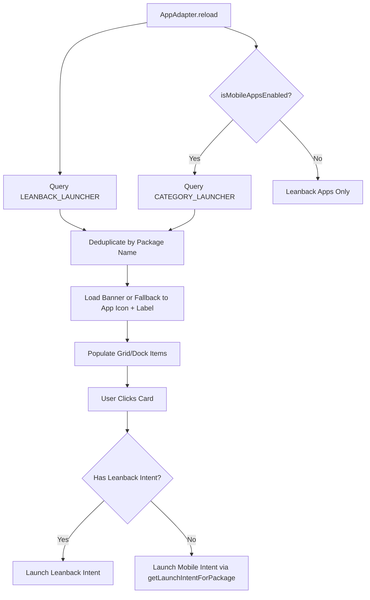

# Show Sideloaded Mobile APKs in TV Launcher Implementation Plan

> **For agentic workers:** REQUIRED SUB-SKILL: Use superpowers:subagent-driven-development (recommended) or superpowers:executing-plans to implement this plan task-by-task. Steps use checkbox (`- [ ]`) syntax for tracking.

**Goal:** Allow Glass TV Home to automatically discover, display, and safely launch sideloaded standard Android mobile/phone APKs alongside native Android TV apps, with a dedicated toggle in Settings.

**Architecture:** 
In Android TV, standard TV launchers query `Intent.CATEGORY_LEANBACK_LAUNCHER`, ignoring sideloaded phone APKs that only declare `Intent.CATEGORY_LAUNCHER`. We extend `AppAdapter.java` to query both intent categories when the preference is enabled (default `true`), deduplicating package names so TV apps take precedence. For launching, we fallback from `getLeanbackLaunchIntentForPackage` to `getLaunchIntentForPackage` so mobile apps start smoothly without `ActivityNotFoundException`. A toggle switch is added to `ModernSettingsDialog.java` under Home Screen settings.

**Architecture Diagram:**

**Tech Stack:** Java, Android SDK (PackageManager, Intent, SharedPreferences), Glass TV Home launcher.

**Spec:** Sideloaded Mobile APK Discovery & Safe Launch Spec.

## Global Constraints
- Must maintain ultra-lightweight APK footprint (< 3MB).
- Must preserve 60fps smooth navigation without causing frame drops or ANRs on 1GB/2GB RAM boxes.
- Mobile apps without 16:9 banners must cleanly display their native square app icon and title.
- Default setting must be enabled (`true`) so newly installed mobile APKs appear immediately.

## Review Focus
1. Apps with multiple launcher activities must not appear as duplicates.
2. Mobile apps requiring phone intent must launch without throwing `ActivityNotFoundException`.
3. Toggling the setting in Settings dialog must immediately refresh the launcher app list.
4. Hidden apps in Child Mode must remain hidden even if they are mobile apps.
5. System internal apps without valid launch intents must be filtered out.

---

### Task 1: Extend App Discovery and Safe Launch in `AppAdapter.java` and `MainActivity.java`

**Files:**
- Modify: `launcher/app/src/main/java/com/gathin/tvhome/AppAdapter.java`
- Modify: `launcher/app/src/main/java/com/gathin/tvhome/MainActivity.java`

- [ ] **Step 1: Add `isMobileAppsEnabled` and `setMobileAppsEnabled` in `MainActivity.java`**
Add getter/setter using SharedPreferences (`theme_prefs`, key `"pref_show_mobile_apps"`, default `true`).

- [ ] **Step 2: Update `AppAdapter.reload()` to query `CATEGORY_LAUNCHER`**
In `AppAdapter.reload()`, when `isMobileAppsEnabled(ctx)` is true:
Query `Intent(Intent.ACTION_MAIN).addCategory(Intent.CATEGORY_LAUNCHER)`.
Add any non-duplicated apps to `found` list.

- [ ] **Step 3: Update `performLaunch(Entry e)` in `AppAdapter.java`**
Instead of blindly adding `CATEGORY_LEANBACK_LAUNCHER`, use `pm.getLeanbackLaunchIntentForPackage(e.pkg)`, falling back to `pm.getLaunchIntentForPackage(e.pkg)`, and falling back to `Intent(Intent.ACTION_MAIN).setComponent(e.component)`.

- [ ] **Step 4: Verify build and test with Gradle**
Run `./gradlew assembleDebug` and confirm clean build.

---

### Task 2: Add Settings Toggle in `ModernSettingsDialog.java`

**Files:**
- Modify: `launcher/app/src/main/java/com/gathin/tvhome/ModernSettingsDialog.java`

- [ ] **Step 1: Add switch row under `TAB_HOME`**
Add:
"📱 Papar Aplikasi Mobile (Show Sideloaded Apps)"
"Papar aplikasi telefon & tablet yang dipasang melalui APK di skrin utama TV"
Checked state: `activity.isMobileAppsEnabled()`
On check change: `activity.setMobileAppsEnabled(isChecked)`, followed by `activity.reloadApps()`.

- [ ] **Step 2: Verify build and test on connected TV**
Run `./gradlew assembleDebug` and install to connected TV via ADB. Verify toggle in Settings.

---

### Task 3: Bump Version, Build Release APKs, and Verify on TV

**Files:**
- Modify: `launcher/app/build.gradle` (versionCode 50, versionName '4.2.3')
- Modify: `release/version.json` (v4.2.3)
- Update: `release/glass-tv-home.apk` and `release/glass-tv-installer.apk`

- [ ] **Step 1: Bump versionCode to 50 and versionName to 4.2.3**
- [ ] **Step 2: Build release APK and install to connected TV**
- [ ] **Step 3: Verify with screenshot on TV**
- [ ] **Step 4: Commit and push v4.2.3 to GitHub**
